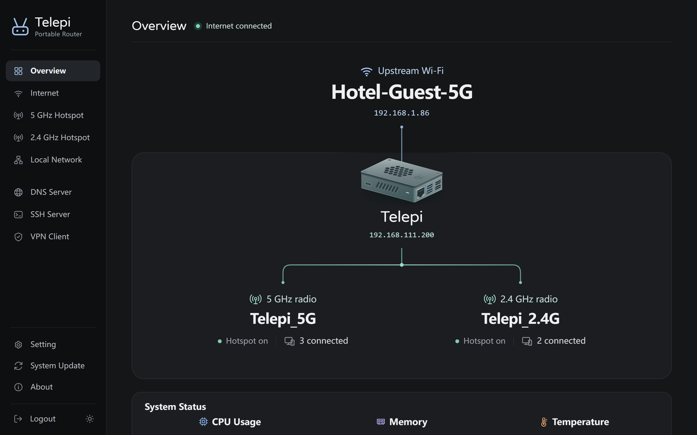
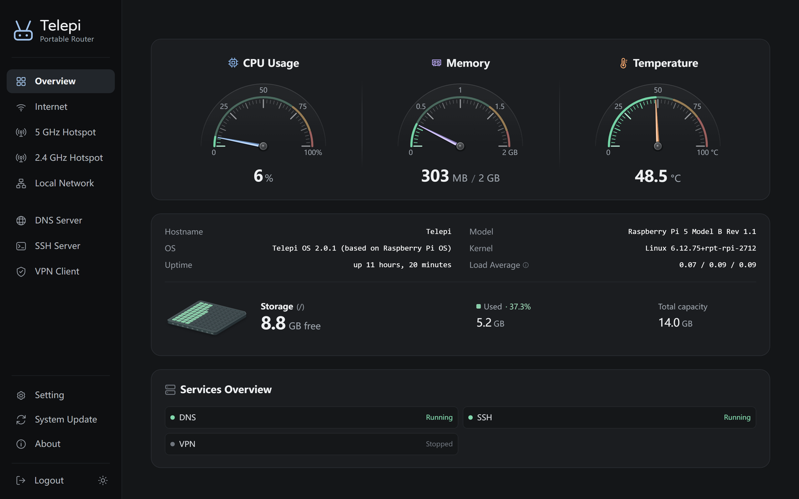
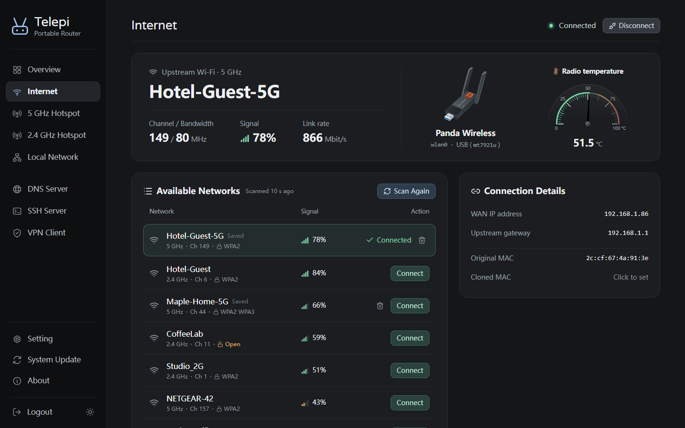
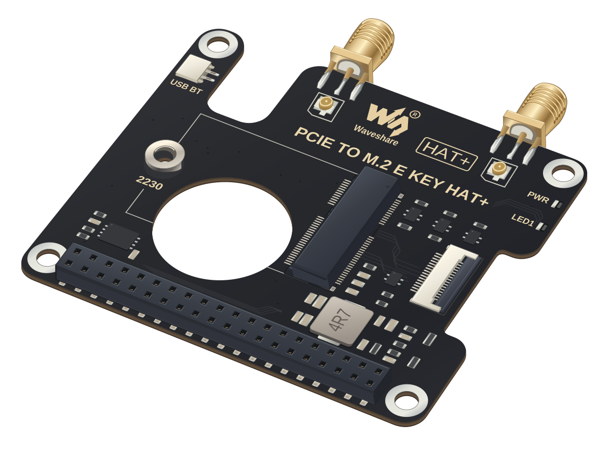
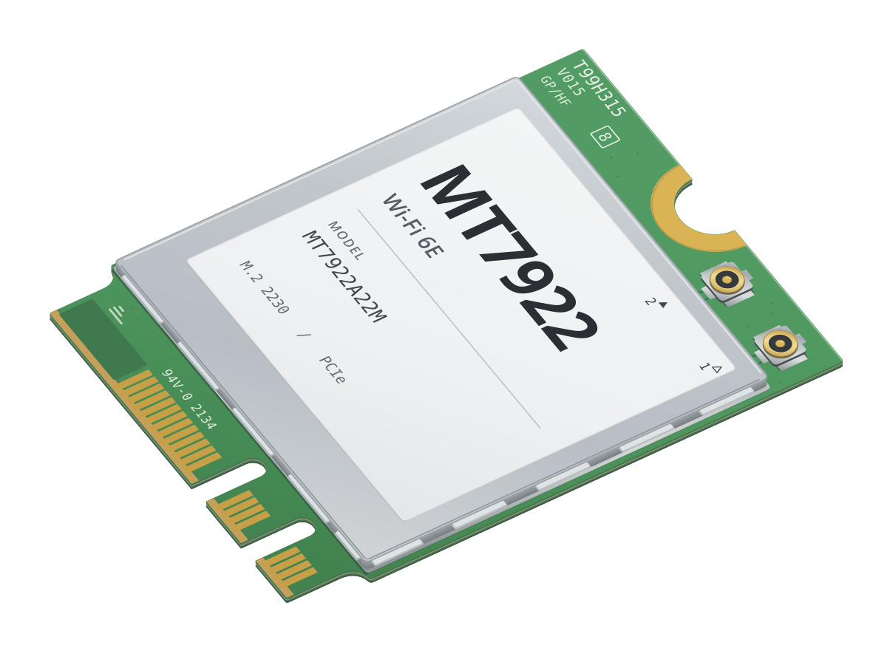
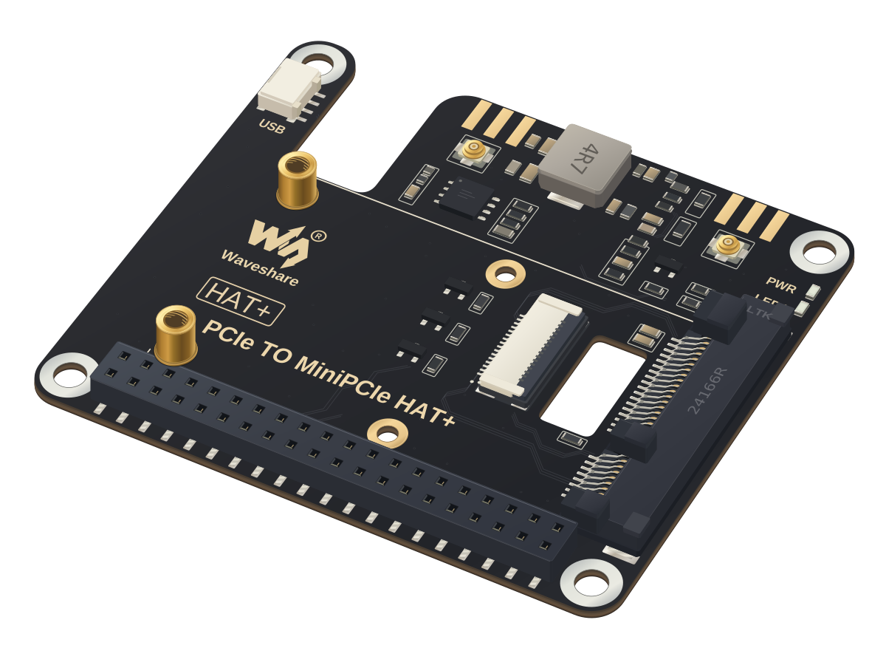
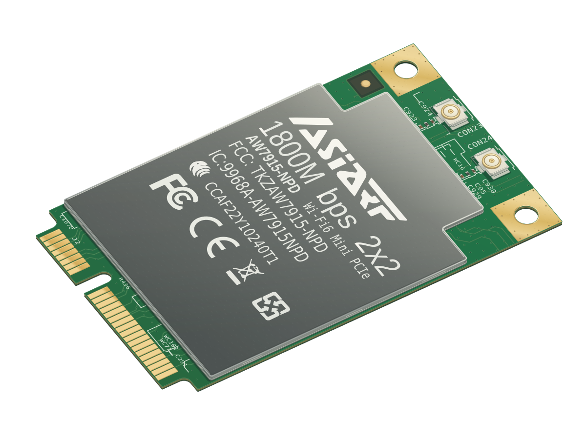

  

<h1 align="center">Telepi</h1>

  <b>Portable Router = WiFi Repeater + WiFi Router.</b> 
  A Raspberry Pi 5 based portable router, powered by <b>Telepi OS</b>. 
  <a href="https://telepi.com/">https://telepi.com/</a>

  
  
  

---

## What is Telepi?

Telepi is a pocket-sized router you build yourself: flash the free **Telepi OS** image
to a Raspberry Pi 5, power it on, and you own a portable WiFi router that travels with you.

Wherever you are — a hotel, an Airbnb, a co-working space, a rented apartment, or at home — Telepi
joins the upstream network, then broadcasts **your own dual-band WiFi** with its own private LAN.
Your devices connect to the same network name and password everywhere, no matter whose network you're on.

**One device. Two roles:**

1. **WiFi Repeater** — joins any upstream WiFi (or a wired Ethernet uplink) and reconnects on its own
2. **WiFi Router** — your own 5G + 2.4G private network with its own LAN

A built-in DNS server filters ads and unsuitable websites for every device, and a WireGuard
client can route the whole network through your VPN.

  

  

  

## Features

| | |
|---|---|
| **WAN** | WiFi repeater, saved networks, automatic reconnect, MAC clone |
| **Wi-Fi** | Dual-band (5G + 2.4G) hotspots, connected-device list, automatic channel selection |
| **LAN** | Your own subnet with DHCP; change it and the router restarts, then your devices pick up the new addresses when they reconnect |
| **DNS Filtering** | Network-level blocking of ads, trackers and malicious domains; your own blocklist for unsuitable websites; allowlist, custom local names, choice of upstream DNS, query log; force DNS redirection |
| **VPN** | WireGuard client — import a profile and cover every device on the network |
| **Management** | Full web UI (light & dark, English / 简体中文 / 繁體中文), one-click upgrade, system logs |
| **Ownership** | Runs entirely on your hardware. No cloud dependency, no telemetry, no accounts, full SSH access |

## Quick Start

1. **Get the hardware** — pick one of the [two builds](#two-builds) below and see the [Hardware List](docs/hardware.md) (Raspberry Pi 5 + off-the-shelf parts)
2. **Download** the latest Telepi OS image (currently **2.1.0**) from [telepi.com](https://telepi.com/products) or [Releases](https://github.com/chenjindu/Telepi/releases/latest)
3. **Flash** it to a microSD card or SSD — see the [Flash Guide](docs/flash-guide.md)
4. **Power on**, connect to the `Telepi-5G-XXXX` or `Telepi-2.4G-XXXX` WiFi hotspot (default password: `telepi.com`)
5. Open **http://192.168.111.200:8080** and log in with `admin` / `telepi.com`
6. Connect to your upstream WiFi on the **Internet** page, then change the default passwords

From download to a working router in about ten minutes.

## Two Builds

Both builds use the same Raspberry Pi 5, USB adapter, antennas, case and power supply. They
differ in the WiFi card that makes your hotspots, and the HAT that holds it.

| | **Build 1 — Starter** | **Build 2 — Pro** |
|---|---|---|
| |   |   |
| HAT + WiFi card | Waveshare PCIe to M.2 E-Key HAT+ with an **MT7922** | Waveshare PCIe to MiniPCIe HAT+ with an **AW7915-NPD / AW7916-NPD** |
| 5G hotspot | MT7922 | AW card |
| 2.4G hotspot | Pi 5 onboard WiFi | AW card |
| In short | Ordinary WiFi cards working as access points; the 2.4G hotspot is weak | A chip made for access points; both hotspots are stable and reliable |
| Telepi OS | 2.0.1, or 2.1.0 and later | 2.1.0 and later |

Telepi OS 2.1.0 detects the hardware on every boot, so one image fits both builds.
Full parts list with pictures: [Hardware List](docs/hardware.md).

## Documentation

- [Architecture](docs/architecture.md) — network topology and system design
- [Hardware List](docs/hardware.md) — full bill of materials with model numbers
- [Flash Guide](docs/flash-guide.md) — writing the image and first boot
- [Configuration](docs/configuration.md) — WAN, Wi-Fi, LAN, DNS filtering, VPN, system

Product tour with screenshots: [telepi.com/tour](https://telepi.com/tour)

## Community & Support

- **Questions / discussion** → [GitHub Discussions](https://github.com/chenjindu/Telepi/discussions) — English, 中文, 日本語 all welcome
- **Bug reports** → [GitHub Issues](https://github.com/chenjindu/Telepi/issues/new/choose)
- **Website** → [telepi.com](https://telepi.com)

## Telepi OS

Telepi OS is the operating system that powers Telepi — based on Raspberry Pi OS Lite, with
everything a portable router needs pre-installed and pre-configured.

## License & Distribution

- The **documentation** in this repository is licensed under the [MIT License](LICENSE).
- The **Telepi OS image** is distributed free of charge for personal and commercial use, as a binary
  image. The Telepi OS source code is not published; this repository is the official distribution
  and documentation home of the product.
- The image is built on Raspberry Pi OS Lite and includes open-source components, each governed
  by its own license.

---

*A personal infrastructure project by [Jindu Chen](https://github.com/chenjindu), shared with the world.*
