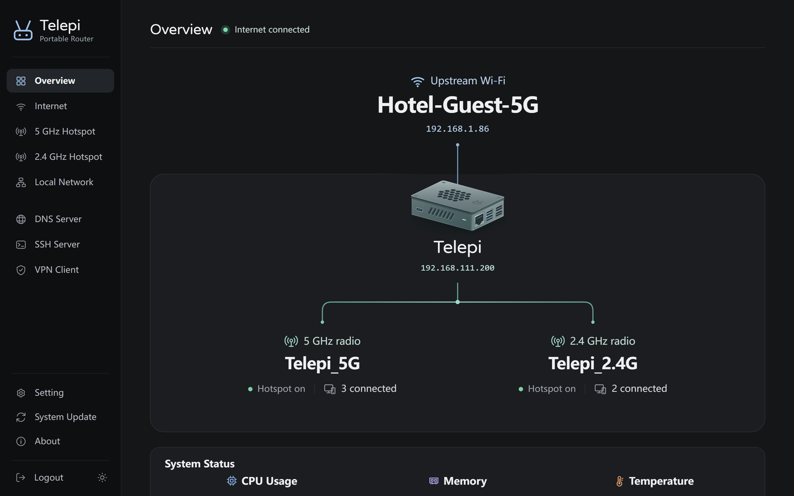
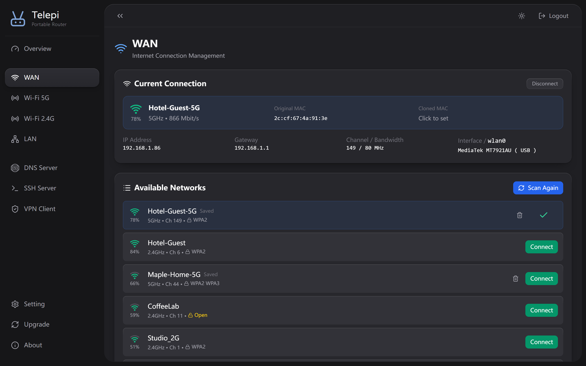
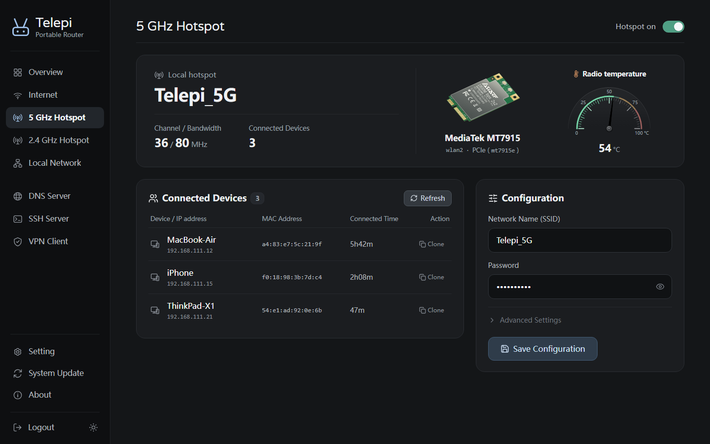
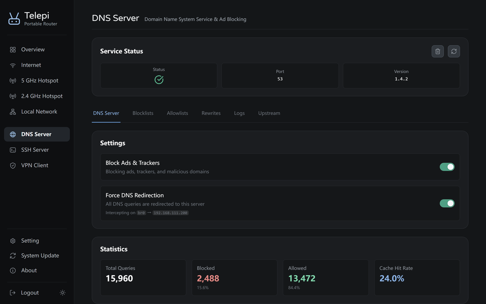
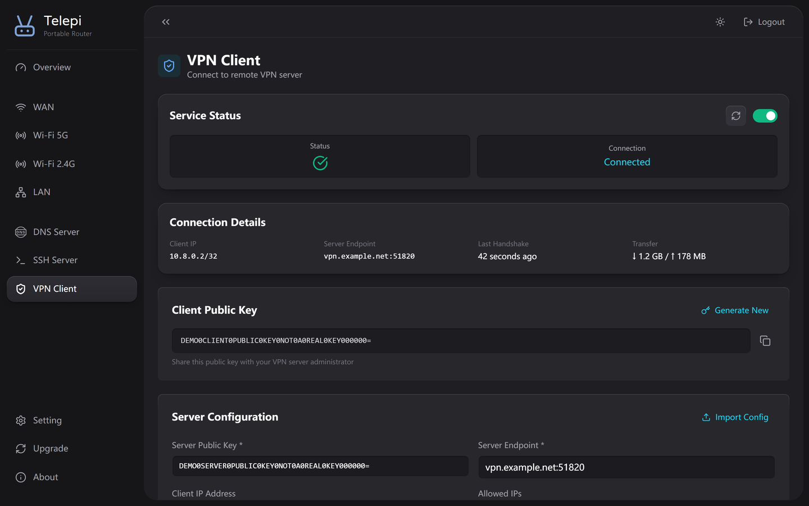

# Configuration

Everything is configured from the web UI at **http://192.168.111.200:8080**
(reachable from any device connected to a Telepi hotspot). Sign in with `admin` / `telepi.com`
on first use. Full SSH access is included for anything beyond the UI.

  

The **Overview** page shows the four things that matter at the top — WAN, LAN, Wi-Fi 5G and
Wi-Fi 2.4G — with system health below.

## WAN — the upstream connection

  

- **WiFi repeater** — scan and join any upstream WiFi (hotel, Airbnb, office, home). Networks are
  saved, so returning to a known place reconnects automatically. The connected network is always
  listed first.
- **Wired Ethernet** — plug an uplink cable into the Gigabit port and Telepi uses it as the WAN.
- **MAC clone** — on networks that only allow one registered device, clone the MAC of a device
  that has already been admitted. All your devices then share that single admission.

A connection watchdog re-establishes a dropped upstream automatically — no manual intervention
when the hotel AP hiccups at 3 a.m.

## Wi-Fi — your own network

  

- **Wi-Fi 5G** and **Wi-Fi 2.4G** are two separate hotspots; set each one's name, password and
  channel independently, or switch one off.
- Each page lists the devices currently connected.
- Channels are chosen automatically, and the 5G hotspot moves out of the way if it would
  collide with the upstream network.

## LAN

- Defaults to `192.168.111.0/24` with the router at `192.168.111.200`.
- Change the subnet, router address and DHCP range if they collide with an upstream network.
- Applying a change restarts the router. Reconnect to the same WiFi and your devices get
  addresses in the new subnet; the page then takes you to the web UI at its new address.

## DNS Filtering

  

Network-level filtering applied to every device automatically — nothing to install on clients:

- **Block Ads & Trackers** — one switch blocks ads, trackers and known malicious domains.
- **Blocklists** — add domains you don't want on your network, such as websites unsuitable
  for children.
- **Allowlists** — force a domain through if the filter is too strict.
- **Rewrites** — give devices on your LAN their own names.
- **Upstream** — choose the upstream DNS servers. A family-safe resolver here filters
  unsuitable content for the whole network.
- **Force DNS Redirection** — devices that try to use another DNS server are redirected to
  Telepi, so nothing sidesteps the filter.
- **Logs** — see what was looked up and what was blocked.

## VPN

  

- **WireGuard client** — import the profile from your VPN provider or your own server.
- When it is on, every device behind Telepi goes through the VPN without per-device setup;
  switch it off and traffic returns to the normal upstream.

## SSH

Turn the SSH server on or off from the **SSH Server** page. Log in as `admin`
(default password `telepi.com` — change it with `passwd`).

## System

- **Setting** — interface language (English / 简体中文 / 繁體中文), web UI password, reboot,
  and system logs.
- **Upgrade** — check for a new version and install it with one click.
- **About** — version information.

## Default Credentials (change these!)

| What | Default |
|---|---|
| Hotspot names | `Telepi-5G-XXXX` and `Telepi-2.4G-XXXX` (XXXX is unique per image) |
| Hotspot password | `telepi.com` |
| Web UI | `http://192.168.111.200:8080` — `admin` / `telepi.com` |
| SSH | `admin` / `telepi.com` |
