# Hardware List (BOM)

Telepi can be built in two ways. Both builds use the same Raspberry Pi 5, USB adapter, antennas,
case, power supply and storage. They differ in one place: **the WiFi card that makes your
hotspots, and the HAT that holds it.**

All parts are off-the-shelf and available worldwide (Amazon links on
[telepi.com/products](https://telepi.com/products)).

## The Two Builds

| | **Build 1 — Starter** | **Build 2 — Pro** |
|---|---|---|
| HAT on the Pi 5 | Waveshare PCIe to M.2 E-Key HAT+ | Waveshare PCIe to MiniPCIe HAT+ |
| WiFi card | MT7922 (M.2) | AsiaRF AW7915-NPD or AW7916-NPD (Mini PCIe) |
| 5G hotspot | MT7922 card, WiFi 5 | AW card, WiFi 6 |
| 2.4G hotspot | Pi 5 onboard WiFi, WiFi 4 | AW card, WiFi 6 |
| Pi 5 onboard WiFi | Runs the 2.4G hotspot | Switched off |
| Upstream WiFi | USB adapter (same in both builds) | USB adapter (same in both builds) |
| Telepi OS | 2.0.1, or 2.1.0 and later | **2.1.0 and later** |

**Build 1 — Starter.** The hotspots come from ordinary WiFi cards, the kind made for laptops,
working as access points. The 5G hotspot works well. The 2.4G hotspot is weak: it comes from
the Pi 5's onboard WiFi, which has only a small antenna on the board, inside the case.

**Build 2 — Pro.** One card with a chip made for access points and routers runs both hotspots.
Both are stable and reliable, and both use the external antennas. This is the build to choose
if you depend on the 2.4G hotspot.

Telepi OS 2.1.0 looks at the hardware on every boot and sets itself up for whichever build
it finds, so both builds use the same image. Telepi OS 2.0.1 works with Build 1 only.

> We build and test Build 2 with the **AW7915-NPD**. The AW7916-NPD uses the same driver and
> is set up the same way, but we have not tested it yet.

## Parts for Both Builds

| # | Picture | Part | Notes |
|---|---------|------|-------|
| 1 | 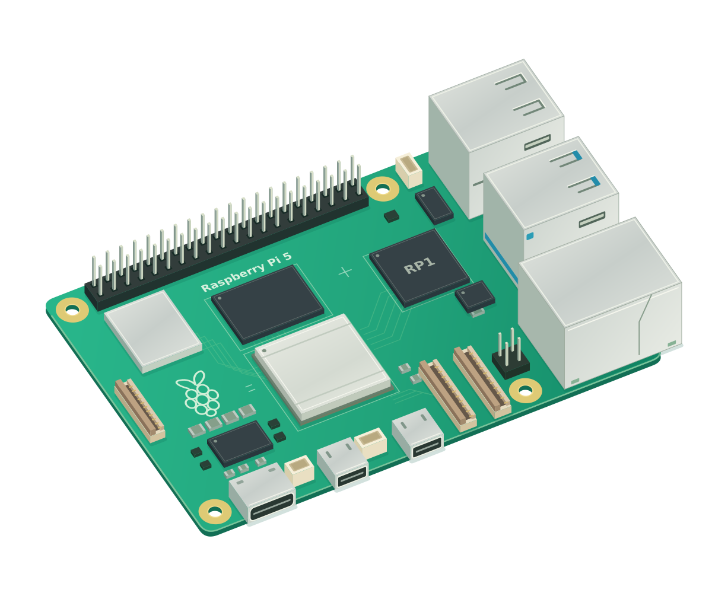 | **Raspberry Pi 5** | 2GB RAM or more |
| 2 | 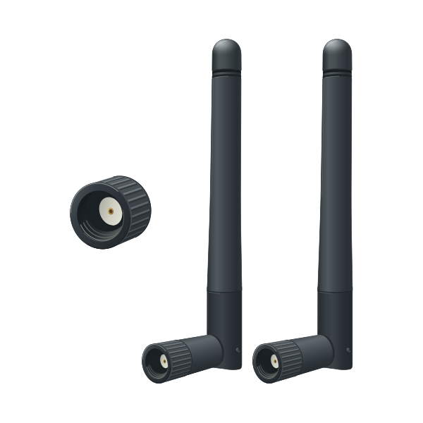 | **Bingfu dual-band antennas (2-pack)** | 2.4/5/5.8 GHz 3dBi MIMO, RP-SMA male; connect to the WiFi card on the HAT |
| 3 | 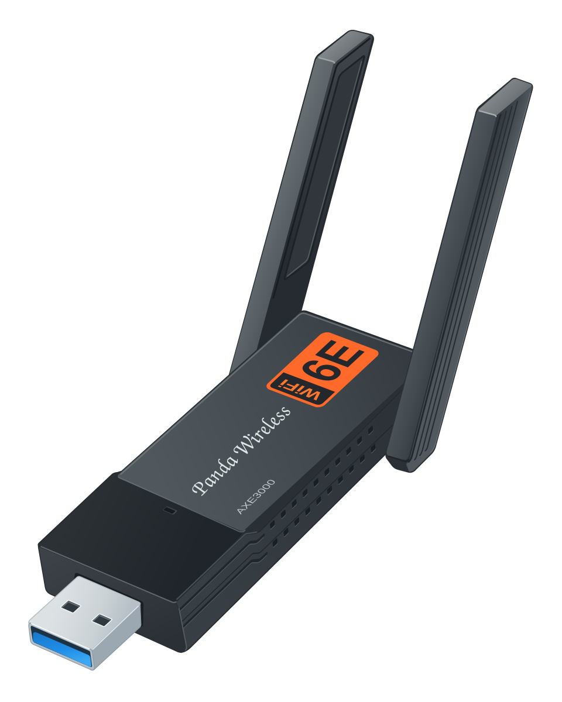 | **MT7921AU USB 3.0 WiFi adapter** | The upstream / repeater radio. Six models to choose from — see [USB adapter models](#usb-adapter-models) below |
| 4 | 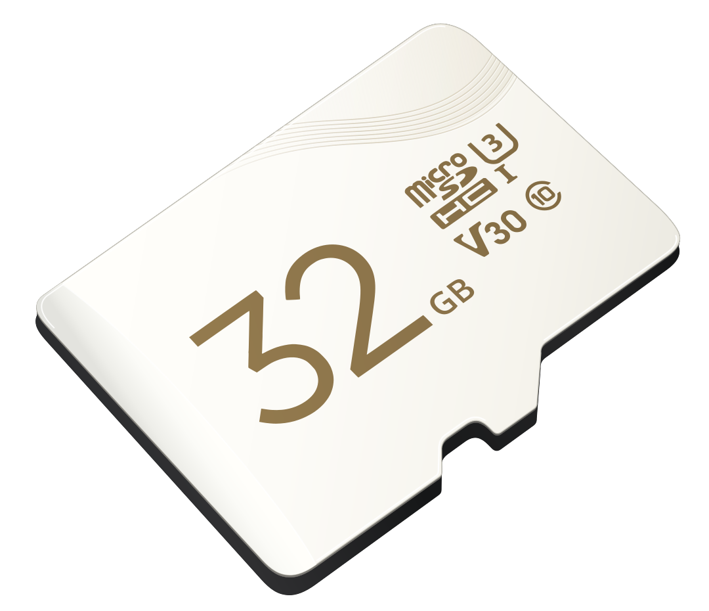 | **microSD card or USB SSD** | 16 GB or larger; an SSD lasts longer under 24/7 use |
| 5 | 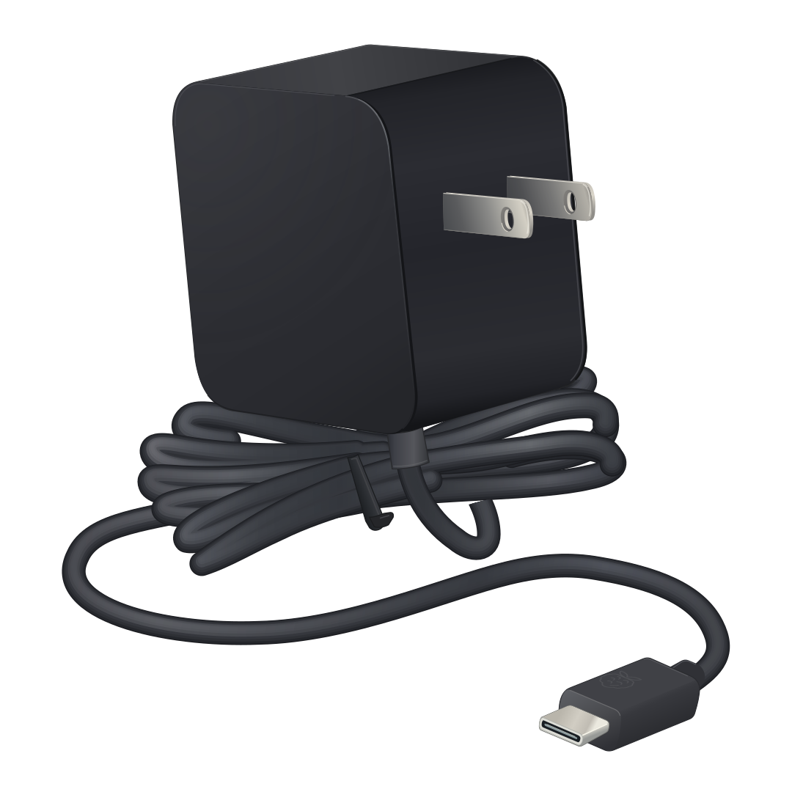 | **27W USB-C power supply** | Official Raspberry Pi 27W PSU recommended — the Pi 5 is picky about power |
| 6 | 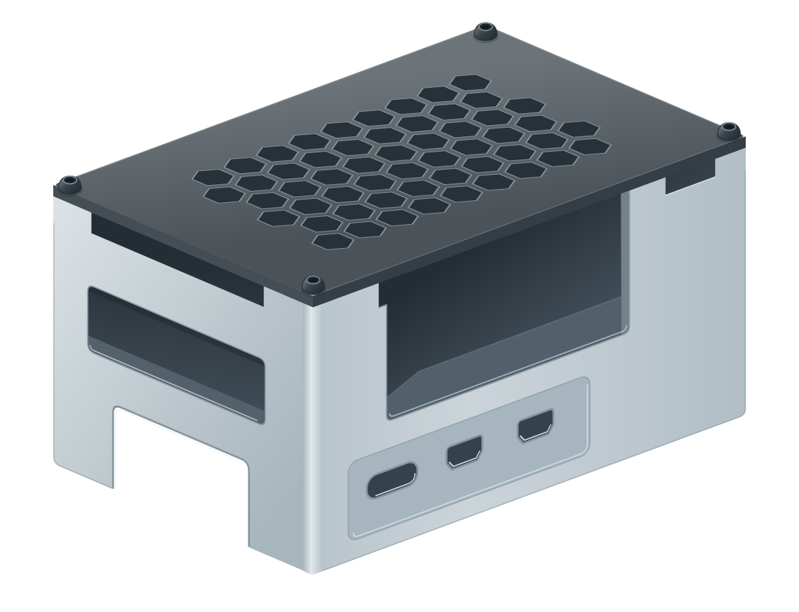 | **GeeekPi aluminum case for Pi 5** | With active cooler; supports PCIe peripheral boards |

## Build 1 — Starter: HAT and WiFi Card

| Picture | Part | Notes |
|---------|------|-------|
| 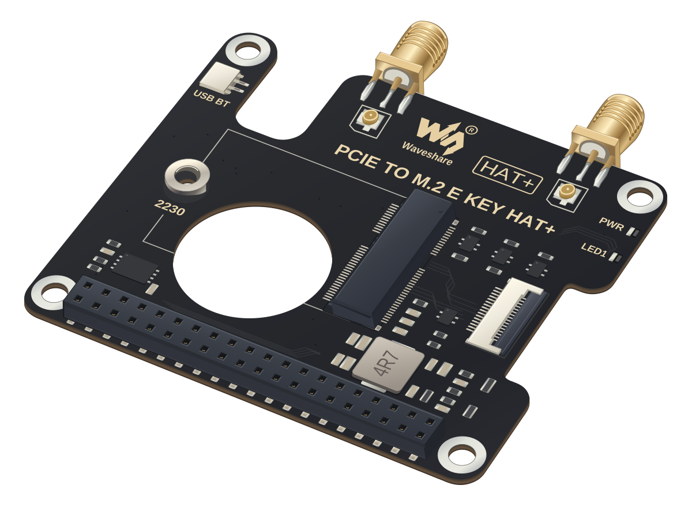 | **Waveshare PCIe to M.2 E-Key HAT+** | For Raspberry Pi 5; takes M.2 E-Key wireless cards; HAT+ standard |
| 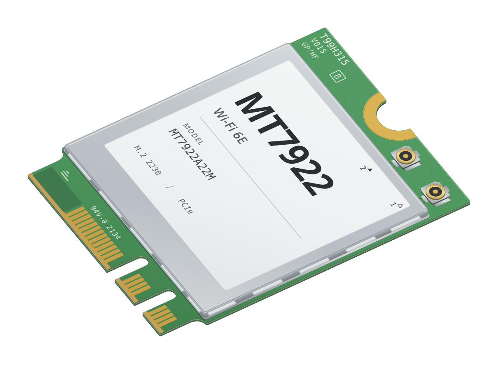 | **MT7922 Wi-Fi 6E network card** | M.2 E-Key; runs the 5G hotspot. The 2.4G hotspot comes from the Pi 5 onboard WiFi |

## Build 2 — Pro: HAT and WiFi Card

| Picture | Part | Notes |
|---------|------|-------|
| 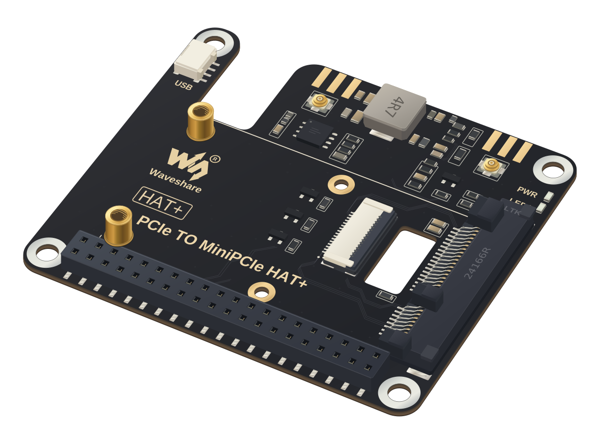 | **Waveshare PCIe to MiniPCIe HAT+** | For Raspberry Pi 5; takes Mini PCIe cards; HAT+ standard |
| 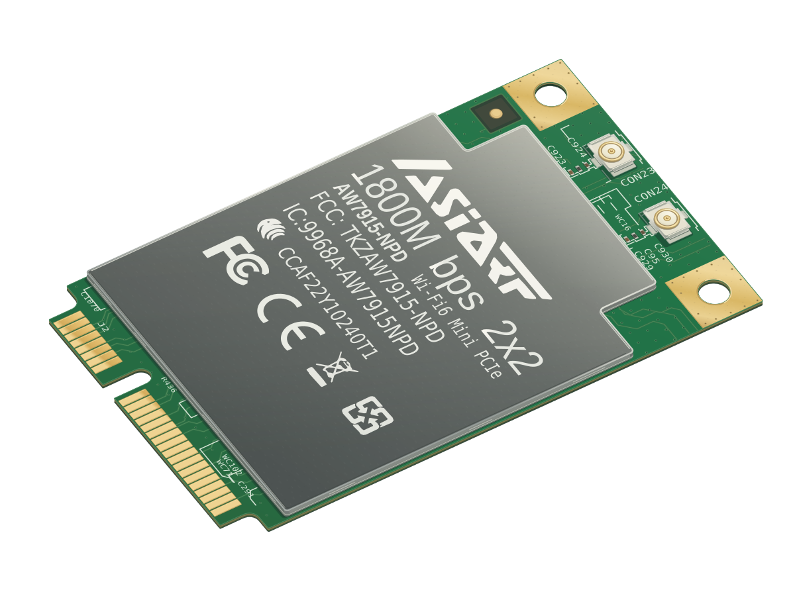 | **AsiaRF AW7915-NPD** (or AW7916-NPD) | Mini PCIe, dual-band WiFi 6; runs the 5G hotspot and the 2.4G hotspot at the same time |

M.2 cards with the MT7925 chip are not supported: the card was unstable as a hotspot in our tests.

## USB Adapter Models

The upstream radio is the same in both builds, and it is the one part where you have a choice
of brands. What matters is the chip: a **MediaTek MT7921AU** (Linux driver `mt7921u`, included
in Telepi OS).

| Picture | Brand | Model | Chip |
|---------|---|---|---|
| 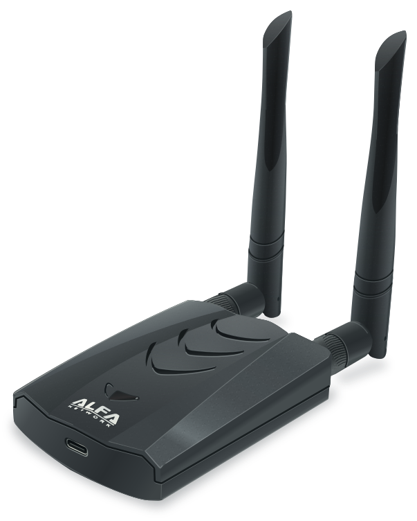 | ALFA Network | AWUS036AXML | MT7921AU |
|  | Panda Wireless | PAU0F AXE3000 Tri Band | MT7921AU |
| 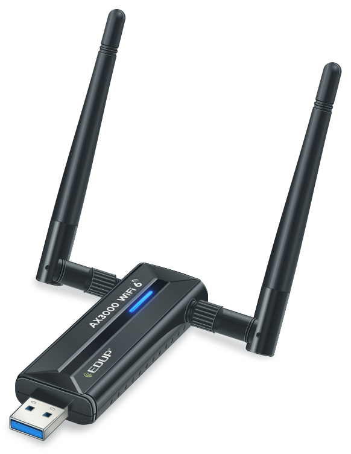 | EDUP | USB 3.0 WiFi 6E Adapter AX3000M | MT7921AU |
| 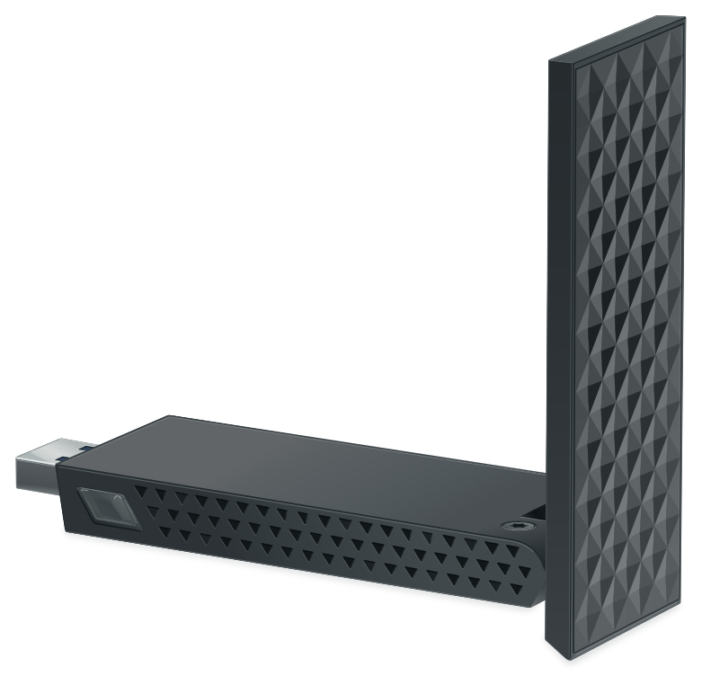 | NETGEAR | Nighthawk A8000 | MT7921AU |
| 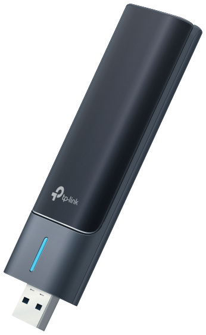 | TP-Link | Archer TXE50UH AXE3000 | MT7921AU |
| 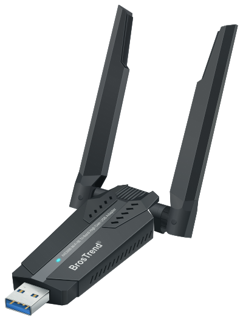 | BrosTrend | AXE3000 | MT7921AU |

Telepi is built and tested with the Panda PAU0F, ALFA AWUS036AXML and EDUP AX3000M.
The other three use the same chip and are expected to work the same way. Check the exact
model name before buying: similar names can hide a different chip.

## Assembly Notes

1. Mount the **active cooler** on the Pi 5 first, then the **PCIe HAT** on top.
2. Fit the WiFi card to the HAT:
   - **Build 1:** insert the **MT7922** into the HAT's M.2 slot and fasten it.
   - **Build 2:** insert the **AW7915-NPD** into the HAT's Mini PCIe slot and fasten it.
3. Connect the two antenna pigtails to the card, and screw the **Bingfu antennas** onto the
   RP-SMA connectors through the case. Fit both antennas before you power the router on.
4. Plug the **USB WiFi adapter** into one of the **blue USB 3.0 ports** (USB 2.0 ports will
   throttle it badly).
5. Insert the flashed microSD / connect the SSD, close the case, connect power. Done.

Both builds use the same Telepi OS 2.1.0 image — see the [Flash Guide](flash-guide.md).
You can also move from Build 1 to Build 2 later: swap the HAT and the card, keep the microSD
card, and Telepi OS sets up the hotspots for the new card on the next boot. Hotspot names and
passwords are kept.

## Minimal Build (reduced feature set)

No PCIe HAT / WiFi card / USB adapter at hand? Telepi OS also boots on a **bare Raspberry Pi 5**.
The onboard WiFi provides the 2.4G hotspot, and DNS filtering and VPN work as usual — but there
is no 5G hotspot, and without the USB adapter there is no radio left for the upstream, so plug
a wired Ethernet uplink into the Gigabit port. This is not a configuration we build and test
with; the two builds above are what give you *simultaneous* repeater + dual-band hotspot.

## Power Consumption

Typical draw is **5–15W** depending on load — comparable to a phone charger.
It runs comfortably from a USB-C power bank that supports PD, which is what makes it
a practical travel companion.
